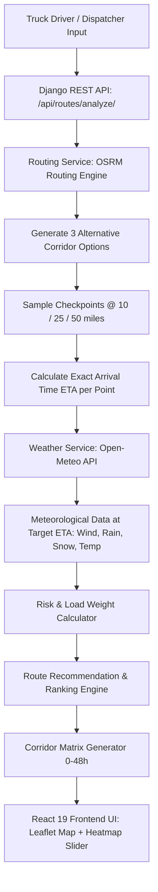

# RouteGuard PRO — Weather-Aware Truck Freight Routing Engine

[](https://python.org)
[](https://djangoproject.com)
[](https://react.dev)
[](https://vitejs.dev)
[](https://leafletjs.com)
[](https://framer.com/motion)

> **Enterprise-grade freight routing intelligence system** that evaluates highway weather conditions, truck gross load weights, and road hazard thresholds to calculate, rank, and visualize the safest transit routes across the United States.

---

## 🌟 Key Highlights & Assessment Compliance

| Requirement | Implementation & Tech Architecture |
|---|---|
| **Origin & Destination** | Dynamic geocoding autocomplete (Photon Komoot API) + 5 pre-configured high-volume commercial freight corridors. |
| **Departure Date/Time** | Precise arrival time forecasting at every checkpoint based on road distance and truck travel speed. |
| **Load Weight Rules** | Real-time weight slider (5k–80k lbs) with automatic safety escalation triggers (Rule 1, Rule 2, Rule 3). |
| **3 Route Alternatives** | Multi-corridor generation via OSRM routing engine with geometric fallback alternates. |
| **Weather Sampling** | Weather checkpoint sampling every **10 / 25 / 50 miles** with hourly forecasts via Open-Meteo. |
| **Risk Classification** | Complete implementation of Wind, Rain, Snow thresholds and Load Weight escalation matrix. |
| **Route Recommendation** | Strict hierarchical preference: Fewest Severe/No-Travel miles &rarr; Fewest High miles &rarr; Lowest Avg Risk &rarr; Shortest Duration. |
| **Interactive Map** | CartoDB Dark Matter Leaflet map, route polyline highlighting, and color-coded checkpoint risk markers. |
| **0–48h Weather Heatmap** | Corridor forecast heatmap with automated radar-style playback animation and metric switcher (Risk, Wind, Rain, Snow, Temp). |

---

## 📐 Architecture & Logic Breakdown



### 1. Weather Risk Classification Matrix

Each checkpoint is classified across three meteorological dimensions:

| Condition | Low (1) | Moderate (2) | High (3) | Severe (4) | No Travel (5) |
|---|---|---|---|---|---|
| **Wind Speed** | `< 25 mph` | `25 – 34 mph` | `35 – 44 mph` | `45 – 54 mph` | `≥ 55 mph` |
| **Rain Rate** | `< 0.10 in/hr` | `0.10 – 0.25` | `0.25 – 0.50` | `0.50 – 1.00` | `> 1.00 in/hr` |
| **Snow Rate** | `< 0.50 in/hr` | `0.50 – 1.00` | `1.00 – 2.00` | `2.00 – 3.00` | `> 3.00 in/hr` |

The checkpoint's **Base Risk** is the maximum across the individual condition risks:
$$\text{Base Risk} = \max(\text{Wind Risk}, \text{Rain Risk}, \text{Snow Risk})$$

### 2. Truck Load Weight Escalation Rules

Trucks with high gross weights or high wind profiles face severe rollover and jackknife hazards. The following rules are strictly enforced:

1. **Rule 1 (Universal Safety):**
   $$\text{Wind} \ge 55\text{ mph} \implies \mathbf{No\ Travel}\quad (\forall\text{ load weights})$$
2. **Rule 2 (Heavy Crosswind Hazard):**
   $$\text{Wind} \in [45, 54]\text{ mph} \land \text{Load} > 30{,}000\text{ lbs} \implies \mathbf{No\ Travel}$$
3. **Rule 3 (Elevated Severe Hazard):**
   $$\text{Wind} \in [35, 44]\text{ mph} \land \text{Load} > 40{,}000\text{ lbs} \implies \max(\text{Risk}, \mathbf{Severe})$$

### 3. Route Recommendation Algorithm

The 3 routes are evaluated and sorted using a lexicographical tuple prioritizing driver safety over raw travel time:

$$\text{SortKey} = (\text{NoTravelMiles}, \text{SevereMiles}, \text{HighMiles}, \text{AverageCorridorRisk}, \text{DurationSeconds})$$

- **1st Priority:** Fewest No-Travel / Severe weather miles.
- **2nd Priority:** Fewest High risk miles.
- **3rd Priority:** Lowest corridor average risk score ($1.00$ to $5.00$).
- **4th Priority:** Shortest travel duration.

### 4. Continuous Corridor Weather Heatmap (0–48 Hours)

- Samples 30+ corridor waypoints along the route network.
- Fetches hourly forecast metrics for all 49 time steps ($T_0$ to $T_{48}$).
- Evaluates the weather risk index at each hour against the truck's load weight.
- Renders smooth radial gradient heatmaps via `leaflet.heat` with automated radar playback animation.

---

## 🛠️ Project Structure

```
RouteGuard/
├── backend/
│   ├── manage.py
│   ├── routeguard_backend/
│   │   ├── settings.py           # CORS, Rest Framework, App config
│   │   ├── urls.py               # Main URL router
│   │   └── wsgi.py
│   └── routing/
│       ├── apps.py
│       ├── urls.py               # API endpoints (/routes/analyze/, /presets/, /geocode/)
│       ├── views.py              # REST API controllers
│       ├── tests.py              # 13 comprehensive unit tests
│       └── services/
│           ├── geocoding.py      # City search & hub presets
│           ├── router.py         # OSRM route generation & checkpoint sampling
│           ├── weather.py        # Open-Meteo hourly forecast client
│           ├── risk_calculator.py# Risk rules & load weight logic
│           └── recommender.py    # Route ranking & AI justification notes
│
├── frontend/
│   ├── package.json
│   ├── vite.config.js            # Vite build & backend API proxy configuration
│   ├── index.html                # App root with SEO and Inter font stack
│   └── src/
│       ├── main.jsx
│       ├── App.jsx               # Master state & view coordinator
│       ├── index.css             # Dark Glassmorphism Design System
│       ├── api.js                # Frontend API client
│       └── components/
│           ├── Header.jsx        # Top bar with API status badge
│           ├── RiskRubricModal.jsx # Official assessment risk matrix modal
│           ├── RouteConfigPanel.jsx # Origin/Dest autocomplete, presets, load slider
│           ├── RouteComparisonList.jsx # 3 Route cards with recommendation badge
│           ├── CheckpointTimeline.jsx # Step-by-step checkpoint hazard timeline
│           ├── HeatmapTimelineSlider.jsx # 0-48h slider with radar playback
│           └── MapViewer.jsx     # Leaflet map with dark tiles, polylines & popups
```

---

## 🚀 Running the Application Locally

### Prerequisites
- **Python 3.10+**
- **Node.js 18+ & npm**

### 1. Backend Setup (Django)

```bash
cd backend

# Create & activate virtual environment (if not already present)
python3 -m venv .venv
source .venv/bin/activate

# Install dependencies
pip install django djangorestframework django-cors-headers requests

# Run database migrations
python manage.py migrate

# Run unit tests to verify algorithms
python manage.py test

# Start the Django API server
python manage.py runserver 127.0.0.1:8000
```
Backend will be live at `http://127.0.0.1:8000/api/`.

### 2. Frontend Setup (React + Vite)

In a new terminal window:

```bash
cd frontend

# Install npm dependencies
npm install

# Start Vite dev server
npm run dev
```
Open `http://127.0.0.1:5173` in your browser.

---

## 🧪 Unit Test Coverage

Run the test suite from the `backend/` directory:
```bash
python manage.py test
```

### Verified Test Cases:
1. `RiskThresholdTests.test_wind_thresholds`: Verifies Low, Moderate, High, Severe, and No Travel wind boundaries.
2. `RiskThresholdTests.test_rain_thresholds`: Verifies `<0.10`, `0.10-0.25`, `0.25-0.50`, `0.50-1.00`, and `>1.00` rain boundaries.
3. `RiskThresholdTests.test_snow_thresholds`: Verifies `<0.5`, `0.5-1.0`, `1.0-2.0`, `2.0-3.0`, and `>3.0` snow boundaries.
4. `LoadWeightRulesTests.test_wind_over_55_no_travel_for_any_load`: Universal safety rule check.
5. `LoadWeightRulesTests.test_wind_45_to_54_with_load_over_30k`: Load elevation to No Travel.
6. `LoadWeightRulesTests.test_wind_35_to_44_with_load_over_40k`: Load elevation to Severe.
7. `LoadWeightRulesTests.test_float_boundaries_between_intervals`: Continuous float boundary safety (e.g. 54.8 mph wind).
8. `RecommenderTests.test_ranking_prefers_fewer_severe_miles`: Recommends Route with 0 severe miles over shorter route with severe miles.
9. `RecommenderTests.test_ranking_prefers_fewer_high_miles_when_severe_tied`: High-mileage tiebreaking.
10. `RecommenderTests.test_ranking_prefers_lower_avg_risk_when_severe_and_high_tied`: Average risk tiebreaking.
11. `ApiIntegrationTests.test_presets_endpoint`: Validates commercial freight corridors.
12. `ApiIntegrationTests.test_geocode_endpoint`: Validates dynamic location search.
13. `ApiIntegrationTests.test_analyze_route_validation_missing_coords`: 400 Bad Request handling.

---

## 🎬 5–10 Minute Loom Walkthrough Script

Use this outline when recording your Loom walkthrough video:

1. **Introduction (1 min)**:
   - Introduce RouteGuard PRO and state the objective: helping commercial truck drivers balance weather risk, load weight, and transit times.
   - Show the clean dark-mode UI with live API status badge.
2. **Risk & Load Weight Rules (1.5 min)**:
   - Open the **Risk Rubric Modal**.
   - Walk through the Wind, Rain, and Snow condition thresholds.
   - Highlight the **Load Weight Rules** (Rule 1: $\ge 55$ mph No Travel; Rule 2: $45-54$ mph $+ >30\text{k}$ lbs No Travel; Rule 3: $35-44$ mph $+ >40\text{k}$ lbs Severe).
3. **Route Configuration & Preset Demonstration (2 min)**:
   - Click the preset `Denver to Seattle` (Mountain Corridor) or `Chicago to Dallas`.
   - Show the truck load weight slider at $42,000$ lbs and point out the active warning badges.
   - Explain the sampling interval selector ($10 / 25 / 50$ miles) and click **Calculate & Rank Safe Routes**.
4. **Route Comparison & Recommendation (2 min)**:
   - Highlight the **Option #1 RECOMMENDED** card with its glowing green badge.
   - Explain why it was chosen based on the 4-tier hierarchy (fewest severe miles, lowest risk score).
   - Compare it against Alternate #2 and #3.
   - Show the proportional risk breakdown bar (green/amber/orange/red/purple).
5. **Interactive Map & Checkpoint Inspector (1.5 min)**:
   - Demonstrate the Leaflet map with CartoDB Dark Matter tiles.
   - Click on different checkpoints along the route to open the popup displaying mile marker, ETA, wind speed, rain rate, and applied safety rules.
   - Toggle through the Checkpoint Timeline filters ("Hazards Only", "Severe Only").
6. **Corridor Weather Heatmap (0–48 Hours) (1.5 min)**:
   - Open the floating Heatmap Controller.
   - Drag the forecast slider from $0\text{h}$ to $48\text{h}$.
   - Hit the **Play** button to watch the animated radar weather front move along the corridor.
   - Switch between metrics: **Risk Index**, **Wind Speed**, **Rain Rate**, **Temperature**.
7. **Conclusion & Code Architecture (0.5 min)**:
   - Mention the clean separation of concerns in Django services and React components.
   - Show all 13 passing tests.

---

## 📄 License
MIT License &copy; 2026 RouteGuard Engineering Team.
